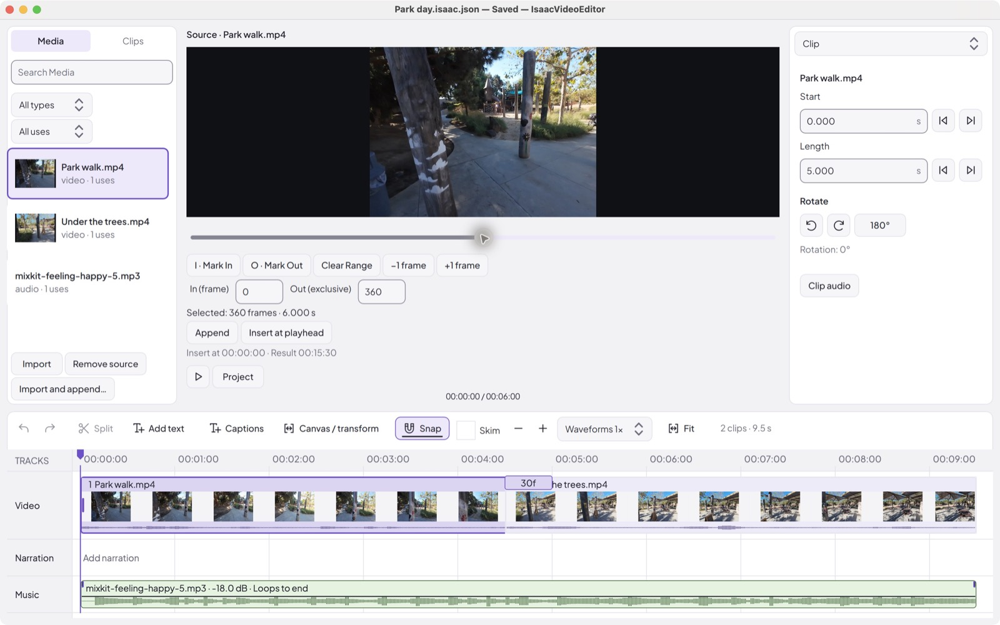
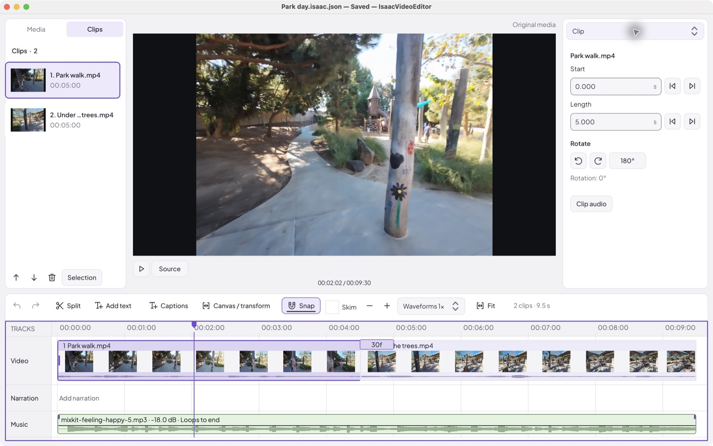
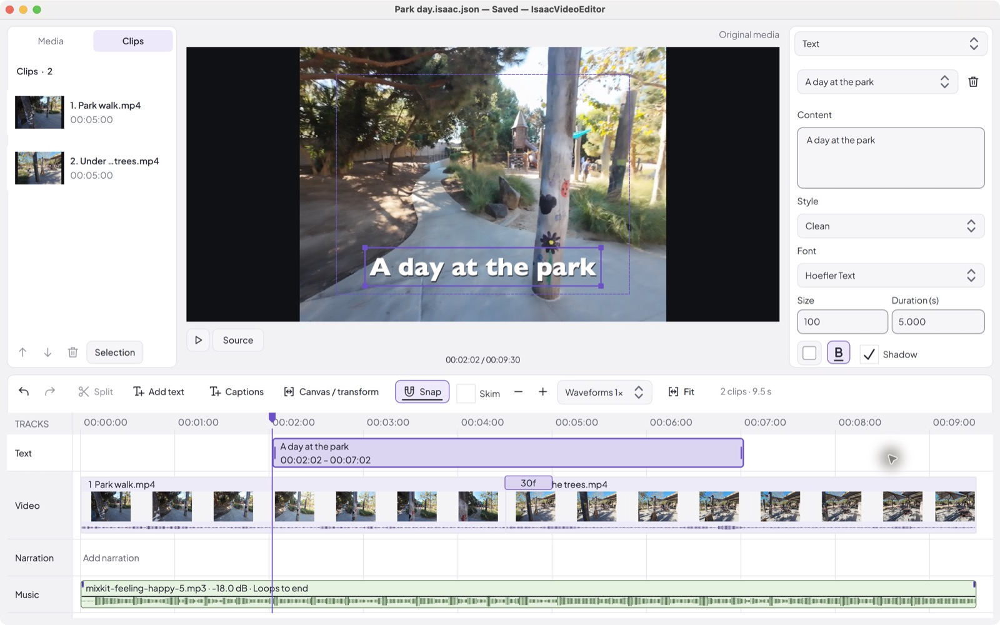
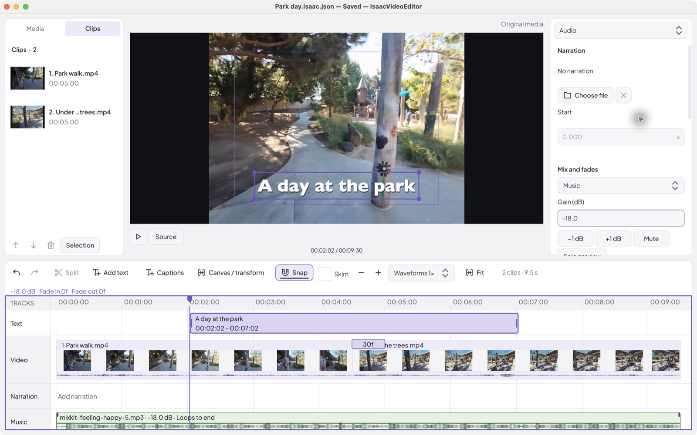

# IsaacVideoEditor

A local video editor for short vlogs. Trim and arrange clips, mix audio, add titles and captions, and export an MP4. No account or paid license required.

Built with C++17, Qt Quick/QML, MLT, and FFmpeg.

## Downloads

Published [GitHub Releases](https://github.com/p-shen/IsaacVideoEditor/releases) get downloads for Apple silicon Macs, Linux x64, and Windows x64 after their release builds pass. These packages include the runtime dependencies. See the [release guide](docs/releases.md) for platform requirements and how to publish or validate a release.

## Build and run

Follow the setup guide for **[macOS](docs/building.md#macos)**, **[Linux](docs/building.md#linux)**, or **[Windows](docs/building.md#windows)**. It includes dependencies, build commands, troubleshooting, and tests.

Requires CMake 3.21+, Qt 6.6+, MLT 7, and FFmpeg. Apple silicon macOS is verified; Intel Mac, Linux, and Windows remain unverified. These are development builds that require their installed dependencies.

## First edit

### 1. Import your footage

Use **File → Import** or drop files into **Media** to build a reusable library. Select a source, mark its range with **I** and **O**, then **Append** it to the end or **Insert at playhead**. For a quicker start, **File → Import and append…** adds videos directly to the edit.

To resume a saved edit, choose **Open Project** in the empty viewer or **File → Open…**.

### 2. Trim and arrange

Select a clip in **Clips** or the timeline. Drag its edges to trim, or enter **Start** and **Length** in the **Clip** inspector. For example, Start 5 s and Length 10 s keeps seconds 5–15.

Move the playhead inside a clip and click **Split**. Drag pieces to reorder them, or use the clip browser’s arrows. **Transitions** sets transitions between clips; splitting inside an active crossfade is disabled. Use the **Clip** menu to rotate footage, or **Transform** to reframe it.

Click the ruler to seek and press **Space** to preview.

### 3. Add titles and captions

Click **Add text** at the playhead. Edit its words and style in **Text**, drag it in the viewer to position it, and move or resize its timeline block to set timing.

Open **Captions** to import SRT files or enter captions manually. Open **Files and all captions** to export SRT or choose **Burn captions into video**. Automatic transcription is not built in.

### 4. Mix audio

In **Audio**, choose **Selected clip audio**, **Narration**, or **Music**. Empty sources offer **Add narration** or **Add music**; **File…** contains file replacement, recent downloads and Mixkit. Narration is imported from a file; microphone recording is not built in.

Volume, mute and music looping stay visible for the selected source. Open **Timing and fades** for fade lengths and narration placement, or **Preview and levels** for solo and metering. You can also drag gain lines and fade handles on the timeline. **Solo preview** affects playback only.

### 5. Save and export

**File → Save** stores a `.isaac.json` project. Keep the original media in place: projects reference files rather than embedding them. If files move, use **File → Recovery and offline media…** to relink them or recover interrupted work.

Choose **File → Export…** for H.264/AAC MP4 at 60 fps. Export reads the original media and uses your canvas settings. **Auto resolution** follows the smallest original video in the edit. You can keep editing while export finishes; it uses the revision captured when you started it.

## Useful controls

| Control | Action |
| --- | --- |
| Space | Play/pause with the workspace focused |
| ← / → | Step one frame with the timeline focused |
| Page Up / Down | Step one second with the timeline focused |
| N / hold Option or Alt | Toggle snapping / temporarily bypass it |
| Fit / − / + | Fit the edit / zoom the timeline |
| Escape | Cancel the current gesture |
| Tab | Move between controls |

**Undo/Redo** is available in **Edit**. Hover or focus a control for help. High-resolution footage gets cached preview copies in the background; export uses the originals.

## More detail

- [Advanced editing](docs/advanced-editing.md): source ranges, audio, recovery, transforms, and transitions.
- [Titles](docs/text-overlays.md) and [captions/SRT](docs/captions.md): styling, timing, and clip attachments.
- [Interface](docs/icon-ui.md) and [accessibility](docs/universal-design.md): layout and keyboard behavior.
- [Implementation notes](docs/qt-quick-migration.md): architecture and verification.
